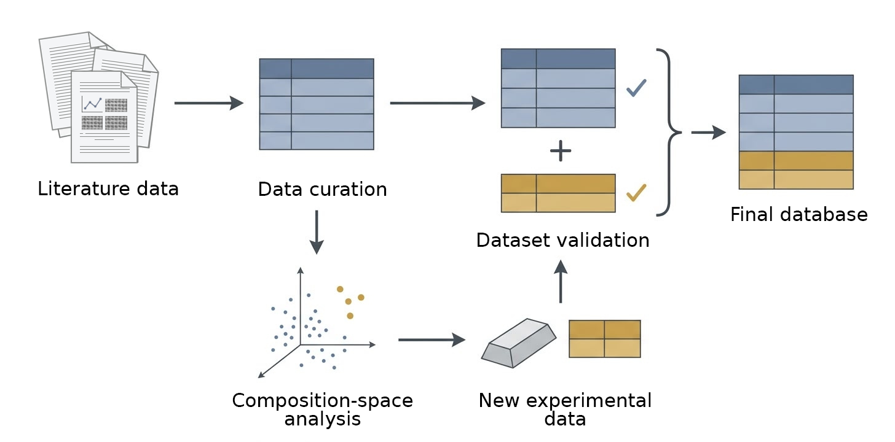

# Fe–Ni–Co–Al–Cr–Ti intermetallic alloys: composition, processing and phase dataset
Data and code accompanying the manuscript *"Composition, processing and phase data for chemically complex intermetallic systems based on Fe–Ni–Co–Al–Cr–Ti"* (under peer review; the citation and dataset DOI will be added after publication).

The repository contains a curated dataset of 386 records on chemically complex (multi-principal-element) alloys of the Fe–Ni–Co–Al–Cr–Ti system with alloying additions (Cu, V, Mo, Hf, W, Ta, B, C, Nb, Mn). Each record links the alloy composition (at.%), the processing route and the experimentally reported phase constitution, with particular attention to the ordered L1₂ (γ′) phase. The repository also includes the code used to audit the data, map the composition space, merge in-house alloys with literature data and validate the final table.



*Fig. 1. Dataset creation workflow: literature data collection, composition-space analysis and experimental extension.*

## Dataset at a glance

| Item | Value |
|---|---|
| Records | 386 |
| Columns | 38 |
| Literature records | 374 (74 papers, 74 distinct DOIs) |
| Records from this work | 12 (samples S1–S12, `DOI = this work`) |
| Records with L1₂ reported (`L12 presence = 1`) | 282 (73.1%) |
| Records with target state FCC + L1₂ (`Target state = 1`) | 183 (47.4%) |

Main files in the repository root:

- `database_final.csv` – machine-readable version. Unreported values are empty; numeric columns stay numeric. Recommended for analysis.
- `database_final.xlsx` – the same data for viewing. Unreported values are shown as the text `NaN`.

## Repository structure

```text
FeNiCoAlCrTi-dataset/
|-- database_final.csv
|-- database_final.xlsx
|-- assets/
|   `-- overview.png
|-- data/
|   |-- raw/
|   |   |-- database_row.xlsx
|   |   |-- experimental_results.xlsx
|   |   `-- experiments/
|   |       `-- xrd_phases.pdf
|   `-- processed/
|       |-- database_filled.xlsx
|       |-- dataset_compositions_unique.parquet
|       `-- dataset_experimental_full.parquet
|-- notebooks/
|   |-- 01_data_audit.ipynb
|   |-- 02_coverage_and_gaps.ipynb
|   |-- 03_build_final_dataset.ipynb
|   `-- 04_technical_validation.ipynb
|-- outputs/
|   |-- figures/
|   |   |-- publication/
|   |   |-- base6_concentration_histograms.pdf
|   |   |-- base6_concentration_histograms.png
|   |   `-- pca3d_composition_space_regions.html
|   `-- tables/
|       |-- technical_validation/
|       |-- data_audit_statistics.xlsx
|       |-- final_dataset_element_statistics.xlsx
|       |-- final_dataset_statistics.xlsx
|       |-- pca3d_gap_pool_base6.xlsx
|       `-- pca_summary.xlsx
|-- src/
|   `-- alloy_space/
|       |-- __init__.py
|       |-- descriptors.py
|       `-- publication_export.py
|-- LICENSE
|-- README.md
`-- requirements.txt
```

| Path | Content |
|---|---|
| `assets/` | Figures used in this README |
| `database_final.csv`, `database_final.xlsx` | Final dataset (386 records, 38 columns): CSV for analysis, XLSX for viewing |
| `data/raw/` | Source tables: literature records (`database_row.xlsx`) and samples of this work (`experimental_results.xlsx`) |
| `data/raw/experiments/` | XRD phase identification for samples S1–S12 |
| `data/processed/` | Intermediate tables produced by notebook 01 |
| `notebooks/` | Analysis pipeline, run in numerical order (01 → 04) |
| `outputs/figures/` | Histograms, interactive 3D PCA map, `publication/` panels (PNG/SVG) |
| `outputs/tables/` | Statistics, PCA summary, gap pool; `technical_validation/` holds validation reports |
| `src/alloy_space/` | Descriptor calculation and figure-export helpers |

Python 3.12 is used for development.

## Reproducing the analysis

Run the notebooks from the repository root in numerical order. Each notebook locates the repository root automatically.

| Notebook | Input | Main outputs |
|---|---|---|
| `01_data_audit` | `data/raw/database_row.xlsx` | `data/processed/database_filled.xlsx`, `dataset_experimental_full.parquet`, `dataset_compositions_unique.parquet`; `outputs/tables/data_audit_statistics.xlsx` |
| `02_coverage_and_gaps` | `data/processed/dataset_compositions_unique.parquet` | PCA summary and gap-pool tables; histograms of base-element concentrations; interactive 3D map `pca3d_composition_space_regions.html`; panels in `outputs/figures/publication/` |
| `03_build_final_dataset` | `data/raw/database_row.xlsx`, `data/raw/experimental_results.xlsx` | `database_final.csv`, `database_final.xlsx`; `final_dataset_statistics.xlsx`, `final_dataset_element_statistics.xlsx` |
| `04_technical_validation` | `database_final.xlsx` | `outputs/tables/technical_validation/` (`validation_report.xlsx`, `validation_summary.csv`, `validation_issues.csv`, `validation_metadata.json`) |

Notebook 02 depends on the output of notebook 01. Notebooks 03 and 04 form a separate chain (03 → 04) and do not need the PCA results.

### Composition-space analysis (notebook 02)

- Concentrations of the six base elements (Ni, Co, Fe, Cr, Al, Ti) are standardized and projected with PCA; the first three components define a 3D map.
- A regular 35-node grid in PC space is converted back to compositions. Physically valid nodes are filtered with a window: VEC ≥ 7.85, Al+Ti = 8.0–12.5 at.%, Al/Ti = 0.9–2.2, atomic-size mismatch δ ≤ 6.0.
- Nodes whose distance to the nearest literature alloy is at or above the 85th percentile form the pool of composition gaps. Twelve candidate compositions were selected from this pool; the corresponding melted alloys are samples S1–S12.
- The interactive HTML map loads plotly.js from a CDN and needs an internet connection.

## Data description

All concentrations are in at.%. Each record is one alloy in one processing state.

| Column | Unit | Description | Missing value |
|---|---|---|---|
| `Paper` | – | Number of the source article from which the row was taken (`S1`–`S12` for samples of this work) | no gaps |
| `Composition, at.%` | – | Alloy formula | no gaps |
| `Ni, Co, Fe, Cr, Al, Ti, Cu, V, Mo, Hf, W, Ta, B, C, Nb, Mn` | at.% | Nominal concentration of each element | 0 = not reported |
| `Sum` | at.% | Sum of all concentrations (range 99.9–100.2), used to check the composition | no gaps |
| `Preparation` | – | Method used to prepare the ingot (15 categories, e.g. `arc-melting`, `induction-melting`, `arc-melting + suction-casting`) | no gaps |
| `HT 1, °C`, `HT 1, min`, `Recrystallization, °C`, `Recrystallization, min`, `Aging 1, °C`, `Aging 1, min`, `Aging 2, °C`, `Aging 2, min` | °C, min | Temperature and duration of each heat-treatment step | 0 = step not applied |
| `Cold deformation, %` | % | Degree of cold deformation | 0 = no deformation |
| `Cooling_after_HT1`, `Cooling_after_Recryst`, `Cooling_after_Aging1` | – | Cooling mode after the corresponding step | empty / `NaN` = not reported |
| `Solvus Temperature, °C` | °C | L1₂ solvus temperature (99 records, 819–1234 °C) | empty / `NaN` = not reported |
| `Phase composition` | – | All phases reported for the record, joined by ` + ` | no gaps |
| `L12 presence` | 0/1 | 1 if L1₂ was reported; assigned only when determined experimentally | no gaps |
| `Target state` | 0/1 | 1 only if the phase composition is exactly FCC + L1₂ | no gaps |
| `L12 fraction, %` | % | Fraction of L1₂ as reported by the authors (115 records, 0–80.1%) | 0 = determined, phase absent; empty / `NaN` = not measured or not reported |
| `DOI` | – | DOI of the source publication (`this work` for samples S1–S12) | no gaps |

### Element coverage

| Element | Records with element | Share | Range, at.% |
|---|---|---|---|
| Ni | 382 | 99.0% | 11.2–60.8 |
| Fe | 372 | 96.4% | 1.3–55 |
| Cr | 365 | 94.6% | 0.6–32 |
| Al | 362 | 93.8% | 1–25 |
| Co | 359 | 93.0% | 4.5–61 |
| Ti | 292 | 75.6% | 1–20 |
| B | 101 | 26.2% | 0.1–1 |
| Nb | 59 | 15.3% | 0.9–10.7 |
| V | 52 | 13.5% | 3–6 |
| Ta | 51 | 13.2% | 0.5–4 |
| Cu | 26 | 6.7% | 1–18.2 |
| Mo | 25 | 6.5% | 0.1–5.1 |
| Mn | 18 | 4.7% | 9.1–23.8 |
| W | 15 | 3.9% | 0.1–1 |
| Hf | 4 | 1.0% | 0.2–0.5 |
| C | 2 | 0.5% | 0.4 |

### Missing-data conventions

- Element concentrations are always filled. A value of 0 means that the element is not reported in the source (in practice, not present in the nominal composition).
- A value of 0 in a temperature or duration column means that the heat-treatment step was not applied. Empty cells of the source table were also converted to 0, so a step that is simply not described in a paper is encoded in the same way.
- Cooling modes, `Solvus Temperature, °C` and `L12 fraction, %` are empty in the CSV and shown as `NaN` in the XLSX when not reported or not measured. A `L12 fraction, %` of 0 is a measured value.
- All percentages in the statistics files refer to records (N = 386), not to unique compositions. The same composition can appear several times with different processing.

## Technical validation

Notebook 04 runs automated checks on `database_final.xlsx`: schema and required fields; numeric ranges; concentration sum (100 ± 0.5 at.%) and agreement with the stored `Sum`; consistency of `L12 presence` and `Target state` with `Phase composition`; L1₂ fraction against the presence flag; consistency of temperature–time pairs of processing steps; source identifiers (integer for literature, `S<n>` with `DOI = this work` for this work); and potential duplicates. Reports are saved in `outputs/tables/technical_validation/`.

The checks do not verify values against the original publications.

## Citation

TODO: add the article and the dataset DOI after acceptance.
